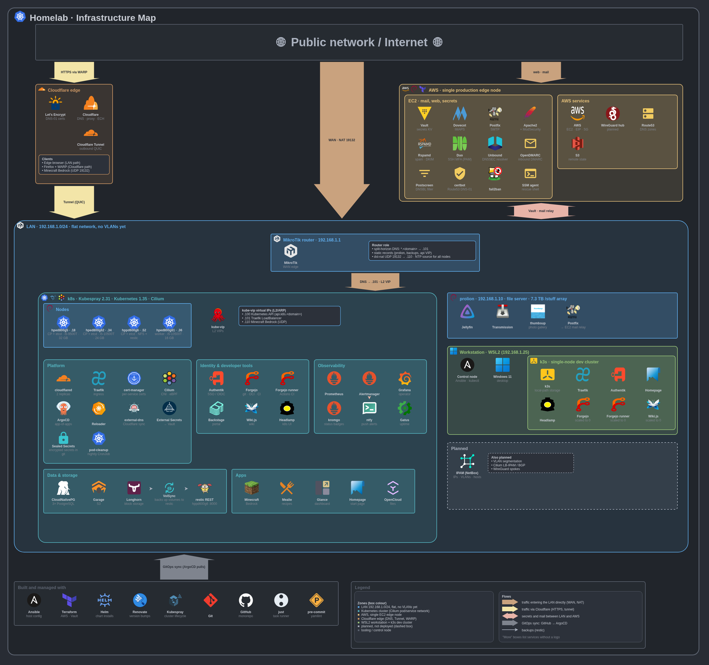
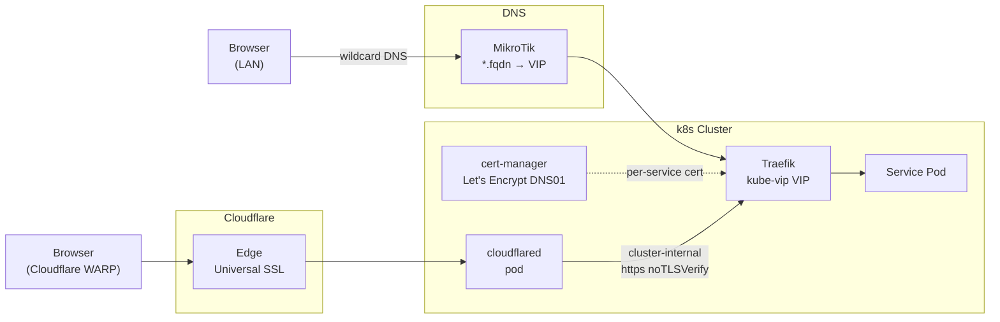

# Just another Homelab IaC or home operations repo

| | |
|:--|:--|
| **repo** | [](https://github.com/kecsi-san/homelab/releases)&nbsp;&nbsp;[](https://github.com/kecsi-san/homelab/actions/workflows/lint.yml)&nbsp;&nbsp;[](LICENSE)&nbsp;&nbsp;&nbsp;&nbsp; |
| **tooling** | [](https://renovatebot.com)&nbsp;&nbsp;[](https://pre-commit.com) |
| **versions** | [](https://github.com/home-operations/kromgo)&nbsp;&nbsp;[](https://github.com/home-operations/kromgo) |
| **health** | [](https://github.com/home-operations/kromgo)&nbsp;&nbsp;[](https://github.com/home-operations/kromgo)&nbsp;&nbsp;[](https://github.com/home-operations/kromgo) |
| **resources** | [](https://github.com/home-operations/kromgo)&nbsp;&nbsp;[](https://github.com/home-operations/kromgo)&nbsp;&nbsp;[](https://github.com/home-operations/kromgo) |
| **cluster** | [](https://github.com/home-operations/kromgo)&nbsp;&nbsp;[](https://github.com/home-operations/kromgo)&nbsp;&nbsp;[](https://github.com/home-operations/kromgo)&nbsp;&nbsp;[](https://github.com/home-operations/kromgo) |

> **The cluster is mostly off.** The k8s cluster is powered down most weekdays and only started when I want to play with it. The badges above are a snapshot saved in [`docs/status-badges/`](docs/status-badges/), so they render even while the cluster is down. They come from [kromgo](https://github.com/home-operations/kromgo) and are refreshed by hand with `just badges-refresh` while the cluster is up. The age badges are only accurate as of that refresh.

---

## 💡 Intro

Everything in this homelab is code: workstations, bare-metal nodes, two Kubernetes clusters, an AWS edge node and the apps on top. The repo follows a modular **LEGO approach**: small, automated, reusable components that work alone and snap together.

- Each Ansible role is self-contained and independently runnable via tags.
- The same roles set up a workstation or a bare-metal Kubernetes node.
- Kubernetes clusters run a self-hosted platform stack managed via GitOps (ArgoCD), so git is the source of truth.
- Secrets never land in git in plaintext: Sealed Secrets, Vault and ansible-vault carry them.

**What is where**

| Path | Contents |
|------|----------|
| `roles/`, `playbooks/`, `inventory/` | Ansible roles and the playbooks that combine them; host and group variables |
| `kube-gitops/` | ArgoCD apps and manifests for the k8s and k3s clusters |
| `terraform/` | AWS edge node, DNS and Vault configuration |
| `docs/` | Guides, research, decision records and the [infrastructure map](docs/infra-map/) |
| `justfile` | One `just <recipe>` per common command; run `just --list` |

### Tool management philosophy

Tools reach a machine through one of three package managers, picked by how often the tool changes:

| Method | macOS | Linux | When to use |
|--------|-------|-------|-------------|
| **APT** | n/a | ✓ | System-level, rarely changing packages; well-maintained in Debian repos |
| **Homebrew** | ✓ formula + cask | ✓ Linuxbrew formula | Frequently updated tools; tools not in APT or lagging upstream |
| **uv** | ✓ | ✓ | Python CLI tools and library packages |

> APT for system stability (Linux), Homebrew for freshness and macOS-native installs, uv for the Python ecosystem.

## 🧭 Infrastructure Map

[](docs/infra-map/homelab-architecture-v0.3-black.drawio.png)

Boxes are network zones, arrows are traffic flows, and logos mark the services. The editable source is [`homelab-architecture-v0.3-black.drawio`](docs/infra-map/homelab-architecture-v0.3-black.drawio) (open it in [diagrams.net](https://app.diagrams.net)), generated by [`homelab-architecture-drawio.py`](docs/infra-map/homelab-architecture-drawio.py).

## <a id="kube"></a>⎈ Clusters

**k8s**: 4-node bare-metal HA cluster running Kubespray 2.31 + Cilium CNI. Three control plane nodes with kube-vip providing a stable API VIP; one dedicated worker. All applications managed by ArgoCD via an app-of-apps pattern.

**k3s**: Single-node development cluster running on WSL2 (penguinaid). Hosts the minimal IDP stack (Authentik, Forgejo + Actions runner, Wiki.js) and a Homepage dashboard for local access; LAN-only, no Cloudflare Tunnel. Uses the same GitOps pattern as the bare-metal cluster with a separate ArgoCD root app.

## 🧱 Stack

### Core Components

- **[Kubespray](https://kubespray.io)**: Kubernetes cluster provisioning on bare metal
- **[Cilium](https://cilium.io)**: CNI with eBPF-based networking and network policy
- **[kube-vip](https://kube-vip.io)**: Control plane HA; API server VIP and Traefik load balancer VIP
- **[ArgoCD](https://argo-cd.readthedocs.io)**: GitOps controller; app-of-apps, two independent cluster stacks
- **[cert-manager](https://cert-manager.io)**: Automated Let's Encrypt certificates via DNS01 (Cloudflare)
- **[Traefik](https://traefik.io)**: Ingress controller; dual-path: LAN cert-manager TLS + Cloudflare Tunnel
- **[Sealed Secrets](https://sealed-secrets.netlify.app)**: Encrypted secrets safe to commit; separate key pairs per cluster
- **[Longhorn](https://longhorn.io)**: Replicated block storage; default `StorageClass`
- **[Ansible](https://www.ansible.com)**: Node provisioning, workstation setup, cluster lifecycle management

### Applications

| Service | Purpose | Access (`.fqdn` = your domain, e.g. `example.com`) |
|---------|---------|--------|
| [Authentik](https://goauthentik.io) | SSO / Identity Provider; OIDC for all platform services | authentik.fqdn |
| [Forgejo](https://forgejo.org) | Self-hosted Git server, OCI registry, and CI runner | forgejo.fqdn |
| [Backstage](https://backstage.io) | Internal developer portal; catalog, scaffolder, TechDocs | backstage.fqdn |
| [Wiki.js](https://js.wiki) | Self-hosted wiki and knowledge base (replaced Outline) | wiki.fqdn |
| [Mealie](https://mealie.io) | Self-hosted recipe manager | mealie.fqdn |
| [Homepage](https://gethomepage.dev) | Start page with live cluster and service widgets | homepage.fqdn |
| [Glance](https://github.com/glanceapp/glance) | Secondary dashboard; weather, markets, HN, Reddit, GitHub trending | glance.fqdn |
| [Headlamp](https://headlamp.dev) | Kubernetes dashboard | headlamp.fqdn |
| [Prometheus + Grafana](https://prometheus.io) | Cluster metrics, Alertmanager alerts, and dashboards | grafana.fqdn |
| [Gatus](https://gatus.io) | Uptime monitoring and status page | gatus.fqdn |
| [Kromgo](https://github.com/home-operations/kromgo) | Public cluster status badges | kromgo.fqdn |
| [ntfy](https://ntfy.sh) | Push notification server; alerts from Gatus, Alertmanager and VolSync | ntfy.fqdn |
| [OpenCloud](https://opencloud.eu) | Self-hosted file storage and sharing; Authentik login, LAN only | opencloud.fqdn |
| [Minecraft (Bedrock)](https://www.minecraft.net) | Family Minecraft server | minecraft.fqdn |
| [Longhorn](https://longhorn.io) | Distributed block storage across all 4 nodes | n/a |
| [CloudNativePG](https://cloudnative-pg.io) | PostgreSQL operator; shared cluster for Forgejo, Authentik, Backstage, Wiki.js | n/a |
| [VolSync](https://volsync.readthedocs.io) | PVC backup operator; restic snapshots to a REST server on the backup host | n/a |
| [Garage](https://garagehq.deuxfleurs.fr) | S3-compatible object storage | n/a |
| [cloudflared](https://github.com/cloudflare/cloudflared) | Cloudflare Tunnel daemon; internet access without open router ports | n/a |
| [external-dns](https://github.com/kubernetes-sigs/external-dns) | Syncs Cloudflare DNS records from IngressRoute annotations | n/a |
| [External Secrets](https://external-secrets.io) | Pulls secrets from Vault; replaces SealedSecrets one app at a time | n/a |
| [Reloader](https://github.com/stakater/Reloader) | Restarts pods when their ConfigMap or Secret changes | n/a |
| pod-cleanup | Nightly CronJob that deletes Failed and Succeeded pods | n/a |

> k8s is the primary homelab cluster. k3s is a development/experimentation mirror but mostly for lightweight services.

### GitOps

ArgoCD manages all applications via an app-of-apps pattern. The root app for each cluster bootstraps everything; from that point ArgoCD self-manages all child apps directly from this repo.

```
kube-gitops/
├── k8s/              # bare-metal 4-node cluster
│   ├── root.yaml     # app-of-apps entry point
│   ├── authentik/
│   ├── forgejo/
│   ├── longhorn/
│   └── ...
└── k3s/              # WSL2 single-node dev cluster
    ├── root.yaml
    ├── authentik/
    ├── forgejo/
    └── ...
```

## 🌐 Networking

Two ingress paths serve all cluster services:



**LAN path:** MikroTik wildcard DNS resolves `*.fqdn` to the Traefik kube-vip VIP. cert-manager issues per-service Let's Encrypt certificates via DNS01 challenge against the Cloudflare API; each service has its own cert and TLS secret.

**Cloudflare path:** Cloudflare WARP routes remote traffic through the Cloudflare edge to a `cloudflared` pod running inside the cluster. Traefik receives it over cluster-internal HTTPS (`noTLSVerify: true`); the browser sees Cloudflare's Universal SSL certificate.

## 🖥️ Hardware

<details>
<summary>Expand</summary>

### Compute

| Hostname | Model | CPU | RAM | Role |
|----------|-------|-----|-----|------|
| hped800g5 | HP EliteDesk 800 G5 Micro | Intel i5-9500T (6C) | 32 GB | Control Plane + etcd |
| hped800g62 | HP EliteDesk 800 G6 Micro | Intel i5-10500T (6C) | 24 GB | Control Plane + etcd |
| hppd600g6 | HP ProDesk 600 G6 Micro | Intel i5-10500T (6C) | 32 GB | Control Plane + etcd + NFS |
| hped800g61 | HP EliteDesk 800 G6 Micro | Intel i5-10500T (6C) | 16 GB | Worker |
| penguinaid | Dev workstation (WSL2) | n/a | n/a | k3s single-node |

### Storage

- **Longhorn**: distributed block storage striped across all 4 kube nodes; default `StorageClass`
- **NFS backup server**: hppd600g6 hosts a 100 GiB LVM volume at `/backups`; restic REST server on `:8000`; daily VolSync snapshots from ntfy, Gatus, and Mealie PVCs

### Network

- **Router / DNS:** MikroTik; wildcard DNS for `*.fqdn` and `*.k3s.fqdn`; NTP server for all cluster nodes
- **Remote access:** Cloudflare Tunnel (`cloudflared` pod in-cluster); Cloudflare WARP for client-side routing

</details>

## ☁️ Cloud Dependencies

| Service | Use | Cost |
|---------|-----|------|
| [Cloudflare](https://cloudflare.com) | DNS, Tunnel (remote access), WARP (client), DNS01 challenge for cert-manager | Free |
| [GitHub](https://github.com) | Repository hosting, CI (Actions), Renovate dependency updates | Free |
| [Let's Encrypt](https://letsencrypt.org) | TLS certificates issued via cert-manager DNS01 | Free |

## 🗺️ Workflows

Step-by-step guides for the three things this repo sets up. Each one runs Ansible playbooks in a fixed order, and each is independent of the others, so pick the one you need. Start with the workstation guide if you are new: the other two assume the tools it installs.

| Guide | Description |
|-------|-------------|
| [Dev/DevOps Workstation](docs/ansible/devenv.md) | Set up a local workstation; macOS or Debian/WSL2 |
| [Local k3s Cluster](docs/ansible/k3s.md) | Single-node k3s cluster for local development (WSL2 + macOS) |
| [4-Node Homelab Cluster](docs/ansible/k8s-homelab.md) | Bare-metal HA cluster, GitOps stack, Cloudflare Tunnel |

## 📚 Reference

Look-up material for when you already know what you want to do. Read Quick Start first for the prerequisites and the commands in one place. Roles explains how the building blocks are named and lists them all. CI/CD covers what runs on every push.

| Guide | Description |
|-------|-------------|
| [Quick Start](docs/ansible/quickstart.md) | Prerequisites and playbook commands for all three scenarios |
| [Roles](docs/ansible/roles.md) | Role naming conventions, structure, and full role inventory |
| [CI/CD](docs/ansible/ci-cd.md) | CI pipeline, linting, pre-commit hooks, and changelog automation |

> Every command in the guides above is also available as a `just <recipe>`: run
> `just --list` at the repo root for the full, discoverable set (setup, playbooks,
> Terraform, lint, cluster rebuild runbook).
>
> The full documentation index is in [docs/README.md](docs/README.md).

---

## 🙏 Thanks

- Inspired by [homelab](https://github.com/topics/homelab), [home operations](https://github.com/topics/home-operations) and similar repositories and communities.
- Kubernetes cluster provisioned with [Kubespray](https://kubespray.io).
